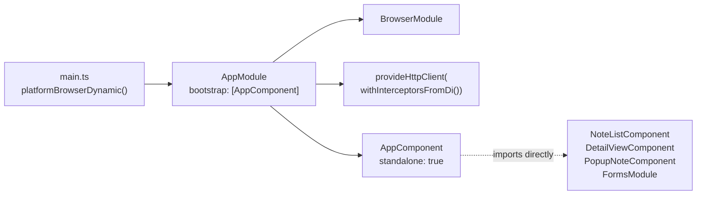
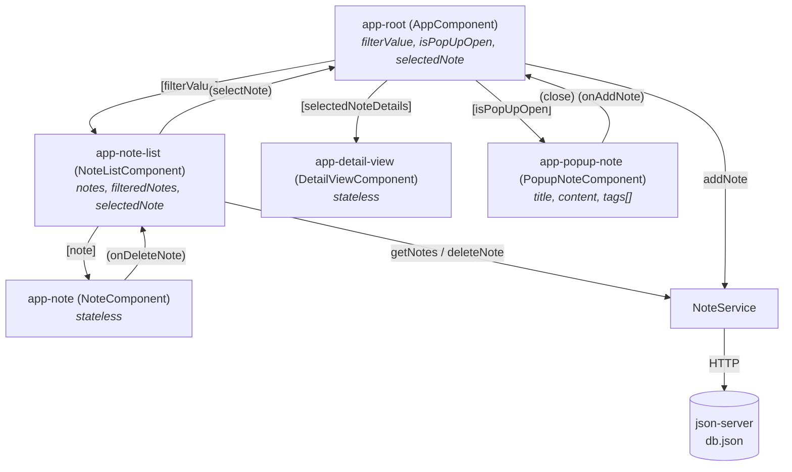

# Architecture — Notes App (Angular)

> Snapshot of the codebase as of 2026-08-17, including the uncommitted standalone-components
> migration in the working tree. Companion document: [improvement.md](./improvement.md).

---

## 1. What this application is

A single-page note manager. The user sees a two-pane layout: a filterable list of notes on the
left, the full text of the selected note on the right, and a full-screen overlay for composing a
new note. Notes persist to a local `json-server` instance backed by [`db.json`](../db.json).

Every note is `{ id?, title, tags: string[], content }`. There is no authentication, no routing,
no offline mode, and no server-side logic beyond what `json-server` provides for free.

**Supported operations:** create, read (list + detail), delete, client-side filter by title.
**Not supported:** editing an existing note, sorting, tag-based filtering, full-text search.

---

## 2. Technology stack

| Layer | Choice | Version | Notes |
|---|---|---|---|
| Framework | Angular | 20.1.x | Standalone components (migration in progress), new `@if`/`@for` control flow |
| Language | TypeScript | 5.8 | `strict: true`, `strictTemplates: true` |
| Change detection | Zone.js | 0.15 | Default zone-based; zoneless not adopted |
| UI components | Angular Material | 20.1.x | Chips, form-field, input, icon only |
| Utility CSS | Tailwind CSS | 3.3 | Via PostCSS + Autoprefixer |
| Component CSS | SCSS | — | Per-component `:host` styling |
| HTTP | `@angular/common/http` | 20.1.x | `provideHttpClient(withInterceptorsFromDi())` |
| Reactivity | RxJS | 7.8 | Observables only; no Signals, no store |
| Backend | json-server | 0.17 | `npm run server`, port 5000 |
| Test runner | Karma + Jasmine | 6.4 / 4.5 | Default CLI scaffolding, never fleshed out |
| Builder | `@angular/build:application` | 20.1.x | esbuild-based |

Four React-ecosystem packages (`@mui/material`, `@mui/icons-material`, `@emotion/react`,
`@emotion/styled`) are declared in [`package.json`](../package.json) but imported nowhere in
`src/` — verified by search. They are inert weight in the dependency tree.

---

## 3. Repository layout

```
Notes-app-Angular/
├── angular.json              # single project "notes-angular"; build/serve/test targets
├── db.json                   # json-server seed data — the actual database
├── package.json              # scripts: start, build, watch, test, server
├── tailwind.config.js        # content glob: ./src/**/*.{html,js}
├── tsconfig{,.app,.spec}.json
└── src/
    ├── index.html            # shell; <app-root> carries the outer layout classes
    ├── main.ts               # bootstrap entry
    ├── styles.scss           # Tailwind directives + Material theme + body background
    └── app/
        ├── app.module.ts     # NgModule — vestigial, see §4
        ├── app.component.*   # shell: filter input, layout, popup orchestration
        ├── Note.ts           # the single domain model
        ├── services/
        │   └── note.service.ts        # the only HTTP boundary
        └── components/
            ├── note-list/    # fetches notes, filters, owns selection
            ├── note/         # renders one note row
            ├── detail-view/  # renders the selected note
            └── popup-note/   # create-note form with tag chips
```

Every component follows the four-file convention (`.ts` / `.html` / `.scss` / `.spec.ts`).
`app.component.scss` and `detail-view.component.scss` are empty files.

---

## 4. Bootstrap chain

The application currently boots through the **legacy NgModule path even though every component is
already standalone**. This is the seam left by the in-flight migration.



[`app.module.ts`](../src/app/app.module.ts) now does exactly two things: supply
`provideHttpClient` and name the bootstrap component. It declares nothing, because all five
components moved to `standalone: true` and declare their own `imports`. The module is a
single-purpose provider bag that `bootstrapApplication` would replace outright.

The intended target — recorded in [`implementation_plan.md`](../implementation_plan.md) Step 2 —
is:

```ts
// main.ts
bootstrapApplication(AppComponent, {
  providers: [provideHttpClient()],
}).catch((err) => console.error(err));
```

…after which `app.module.ts` and the `platform-browser-dynamic` dependency both disappear.

---

## 5. Component tree and contracts



| Component | Inputs | Outputs | Local state | Talks to service |
|---|---|---|---|---|
| `AppComponent` | — | — | `filterValue`, `isPopUpOpen`, `selectedNote`, `notes` (unused) | `addNote` |
| `NoteListComponent` | `filterValue` | `selectNote` | `notes`, `filteredNotes`, `selectedNote` | `getNotes`, `deleteNote` |
| `NoteComponent` | `note` | `onDeleteNote` | — | no |
| `DetailViewComponent` | `selectedNoteDetails` | — | — | no |
| `PopupNoteComponent` | `isPopUpOpen` | `close`, `onAddNote` | `title`, `content`, `tags` | no |

Communication is entirely `@Input`/`@Output` chaining through `AppComponent` as the orchestrator.
No shared store, no service-level state, no router.

---

## 6. State ownership — the central architectural issue

The note collection has **two independent owners that never synchronise**:

```mermaid
graph TD
    subgraph AppComponent
        AN["notes: Note[]<br/>← addNote() pushes here<br/>❌ bound to no template"]
    end
    subgraph NoteListComponent
        LN["notes: Note[]<br/>← getNotes() fills here<br/>✅ this is what renders"]
        FN["filteredNotes: Note[]<br/>← only recomputed in ngOnChanges"]
    end
    Svc["NoteService"] -->|POST| AN
    Svc -->|GET / DELETE| LN
    LN -.->|filterNotes---on filterValue change only.-> FN
```

Three consequences fall out of this shape:

1. **Creation is invisible.** `AppComponent.addNote` pushes the server's response into
   `AppComponent.notes` ([app.component.ts:33](../src/app/app.component.ts#L33)), an array no
   template reads. The list only refreshes on reload.
2. **Filtering drifts from truth.** `filteredNotes` is a manually maintained snapshot refreshed
   solely by `ngOnChanges` on `filterValue`. Deleting while a filter is active mutates `notes` but
   leaves `filteredNotes` stale.
3. **Selection can outlive its note.** `AppComponent.selectedNote` holds an object reference; the
   list never signals deletion upward, so the detail pane can display a note that no longer exists
   server-side.

`notesToDisplay` in [note-list.component.ts:21](../src/app/components/note-list/note-list.component.ts#L21)
is a getter that switches between the two arrays based on whether `filterValue` is empty — a
manual cache-invalidation protocol that a `computed()` signal would make structurally impossible
to get wrong. This is precisely what Phase 2 of the implementation plan proposes.

---

## 7. Data layer

[`NoteService`](../src/app/services/note.service.ts) is `providedIn: 'root'` and is the only place
in the codebase that performs I/O. It is a thin, stateless mapping onto json-server's REST
conventions:

| Method | Verb | URL | Returns |
|---|---|---|---|
| `getNotes()` | GET | `{apiUrl}` | `Observable<Note[]>` |
| `addNote(note)` | POST | `{apiUrl}` | `Observable<Note>` (server assigns `id`) |
| `deleteNote(note)` | DELETE | `{apiUrl}/{note.id}` | `Observable<Note>` |

`apiUrl` is a hardcoded private field, not an environment token — there is no
`environments/` directory, so the endpoint cannot vary between dev and prod builds.

**The configured port is wrong.** `apiUrl` targets `localhost:3000`; `npm run server` starts
json-server on `5000`. Git history shows the value was `5000` until commit `0d55b21`
("Formatting Code") changed it to `3000` alongside genuine whitespace edits. Every HTTP call in
the app currently fails.

No `catchError`, no retry, no loading flags, no `takeUntilDestroyed` — subscriptions in
`ngOnInit` and click handlers are never explicitly torn down. For `HttpClient` observables that
complete after one emission this leaks nothing in practice, but it establishes a pattern that will
leak as soon as a long-lived stream is introduced.

---

## 8. Backend

`json-server --watch db.json --port 5000` provides full REST over a flat JSON file. `db.json`
holds a `notes` collection; ids are numeric and server-assigned. The file is committed, so it
doubles as seed data and as a developer's scratch database — and currently carries a manual-test
record (`"§$RTQWE` / `WDSRFGWERG`) that was checked in by accident.

There is no proxy configuration in `angular.json`, so the browser calls the API cross-origin
(`:4200` → `:5000`). json-server permits this by default; a real backend would need
`proxy.conf.json`.

---

## 9. Styling architecture

Three styling systems are layered, with responsibilities that overlap rather than compose:

1. **Tailwind utilities** — carry nearly all layout and colour, written inline in templates. The
   content glob is `./src/**/*.{html,js}`, which covers templates but **not** `.ts` files, so any
   class written in a TypeScript string would be purged.
2. **Angular Material** — the prebuilt `pink-bluegrey` theme is imported wholesale in
   [`styles.scss`](../src/styles.scss), then fought back with Tailwind overrides and a lone
   `--mat-theme-primary: white` custom property. Only four Material modules are actually used.
3. **Component SCSS** — `:host` blocks for behaviour Tailwind cannot express: the popup's
   open/closed transition, note hover/active states, scrollbar theming.

The popup's visibility is a pure-CSS concern: the host is always in the DOM, hidden by
`opacity: 0; pointer-events: none`, revealed by an `.open` class bound from the parent
([popup-note.component.scss:12-21](../src/app/components/popup-note/popup-note.component.scss#L12-L21)).
The component is never destroyed, so its form state and DOM persist across open/close cycles.

Two external font sources are fetched at runtime: Google's Material Icons via an `@import` inside
`styles.scss`, and rsms.me's Inter via a `<link>` in `index.html`. `index.html` also links
`/dist/output.css`, a file no build target emits — a leftover from a standalone Tailwind CLI
workflow, which the build reports as `Unable to locate stylesheet`.

---

## 10. Build, test, and tooling

```
npm start        → ng serve            (dev server, :4200)
npm run build    → ng build            (production by default)
npm run server   → json-server :5000   (must run alongside)
npm test         → ng test             (Karma, headed Chrome)
```

**Build status (verified):** succeeds in ~4 s. Two warnings:
- initial bundle 559.30 kB against a 500 kB budget (59.30 kB over)
- `Unable to locate stylesheet: C:\dist\output.css`

**Test status (verified):** `tsc -p tsconfig.spec.json --noEmit` fails —
`app.component.spec.ts(20,16): error TS2339: Property 'title' does not exist on type
'AppComponent'.` The whole spec compilation aborts, so `npm test` cannot run at all. Separately,
all five specs still register components via TestBed `declarations`, which is invalid for
standalone components and would throw in every `beforeEach` even once the type error is fixed. The
specs are untouched CLI scaffolding: five "should create" assertions and two `AppComponent`
assertions about a `title` property that never existed here.

There is no linter (`ng lint` is unconfigured), no formatter config beyond `.editorconfig`, no
e2e harness, and no CI workflow.

---

## 11. Cross-cutting characteristics

| Concern | Current state |
|---|---|
| Routing | None — `@angular/router` is a dependency but never imported |
| Change detection | Default (`Zone.js`); no `OnPush` anywhere |
| Error handling | None — a failed request silently produces nothing |
| Loading states | None |
| Accessibility | Notes are clickable `<app-note>` elements with no role or tab stop; delete is a bare `<mat-icon>`; the hidden popup remains focusable |
| Responsiveness | Desktop-only: `w-3/4`, `w-1/2` split, fixed `min/max-h-[550px]` |
| i18n | `extract-i18n` target exists; no translations |
| Environments | No `environments/` directory; API URL hardcoded |
| Persistence | Server-side only; no optimistic updates, no local cache |

---

## 12. Structural debt, in one place

Ranked by how much they constrain future work — details and fixes in
[improvement.md](./improvement.md).

1. **Half-finished standalone migration.** Components converted; `main.ts`, `app.module.ts`, and
   all five specs were not. The build hides this; the test suite does not.
2. **Duplicated note state** across `AppComponent` and `NoteListComponent`, with a manually
   invalidated `filteredNotes` cache. Root cause of the create-invisible and stale-filter bugs.
3. **Hardcoded, currently-wrong API URL** with no environment indirection.
4. **No error or loading path** through the HTTP layer.
5. **Non-functional test suite**, so no change can be verified automatically.
6. **Three overlapping styling systems** plus four unused React dependencies inflating the bundle
   past its budget.

---

## 13. Where the codebase is heading

[`plan.md`](../plan.md) and [`implementation_plan.md`](../implementation_plan.md) (both untracked)
already sketch a v2.0: finish the standalone migration, introduce a Signals-based
`NoteStateService`, add edit support and Markdown rendering, make the layout responsive, and
eventually wrap the app with Tauri (desktop) and Capacitor (mobile). Those plans correctly
identify the port mismatch and the unused MUI dependencies. The architecture above is the
starting point they assume — with the caveat that the migration is currently mid-flight rather
than complete.
